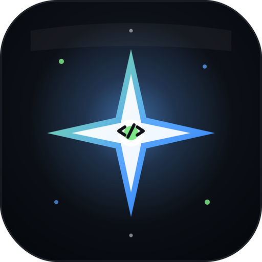
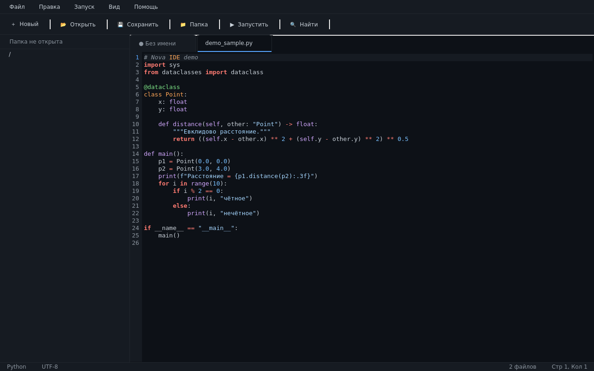
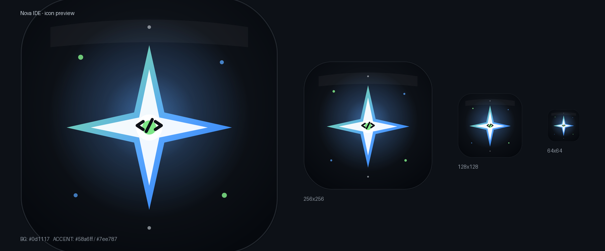

<div align="center">

# Nova IDE

### Лёгкая красивая IDE на Python + PySide6

[](https://python.org)
[](https://www.qt.io/qt-for-python)
[](https://pyinstaller.org)
[](LICENSE)
[](#установка)
[](https://github.com/YOUR_USERNAME/nova-ide/stargazers)



Тёмная тема · Подсветка 8 языков · Вкладки · Файловое дерево · Поиск/Замена · Запуск кода · Standalone-бинарник



</div>

---

## Возможности

- **Тёмная тема «Nova»** — палитра в стиле GitHub Dark с акцентами `#58a6ff` и `#7ee787`
- **Вкладки** — перетаскиваемые, с индикатором `●` несохранённых файлов
- **Файловое дерево** — двойной клик открывает файл; корень = ваша папка проекта
- **Редактор кода**
  - Нумерация строк с подсветкой текущей строки
  - Моноширинный шрифт (JetBrains Mono → Fira Code → Menlo → DejaVu Sans Mono)
  - Подсветка синтаксиса для **8 языков**: Python, JavaScript/TypeScript, HTML, CSS, JSON, C/C++, Shell, Markdown
  - Масштаб шрифта (`Ctrl` + `+`/`-`)
- **Поиск и замена** — с поддержкой «Заменить все»
- **Запуск кода (F5)** — Python / Node.js / Bash; вывод в отдельной вкладке
- **Статус-бар** — язык, кодировка, кол-во файлов, позиция курсора
- **Меню** — Файл, Правка, Запуск, Вид, Помощь
- **Stand-alone бинарник** — Linux ELF 69 МБ, запускается без Python

## Скриншот


Иконка приложения во всех размерах:



## Установка

### Вариант 1: Запуск из исходника (любая ОС)

```bash
git clone https://github.com/YOUR_USERNAME/nova-ide.git
cd nova-ide
pip install -r requirements.txt
python nova_ide.py
```

> Требуется Python 3.9+ и PySide6 ≥ 6.5.

### Вариант 2: Готовый Linux-бинарник

Скачайте `NovaIDE` из [Releases](../../releases), затем:

```bash
chmod +x NovaIDE
./NovaIDE
```

Если ругается на отсутствующие библиотеки (libEGL и т.п.):

```bash
sudo apt install libegl1 libgl1 libxkbcommon0 libdbus-1-3 \
                libfontconfig1 libfreetype6 libxcb-cursor0 \
                libxcb-xinerama0
```

### Вариант 3: Сборка Windows `.exe`

**Локально** (нужна Windows с Python 3.9+):

1. Скачайте репозиторий
2. Двойной клик по `build_exe.bat`
3. Готовый файл появится в `dist\NovaIDE.exe`

**В облаке через GitHub Actions** (см. ниже) — не нужна Windows на машине:

1. Запушьте репозиторий на GitHub
2. Откройте вкладку **Actions** → workflow **Build Windows .exe**
3. Скачайте `NovaIDE.exe` из artifacts

## Горячие клавиши

| Клавиша | Действие |
|---|---|
| `Ctrl+N` | Новый файл |
| `Ctrl+O` | Открыть файл |
| `Ctrl+S` | Сохранить |
| `Ctrl+Shift+S` | Сохранить как… |
| `Ctrl+Shift+O` | Открыть папку проекта |
| `Ctrl+W` | Закрыть вкладку |
| `Ctrl+F` | Найти / Заменить |
| `Ctrl+Tab` | Следующая вкладка |
| `Ctrl+Shift+Tab` | Предыдущая вкладка |
| `Ctrl` + `+` | Увеличить шрифт |
| `Ctrl` + `-` | Уменьшить шрифт |
| `F5` | Запустить (Python / Node / Bash) |
| `F1` | О программе |

Полный список — в [docs/HOTKEYS.md](docs/HOTKEYS.md).

## Структура репозитория

```
nova-ide/
├── nova_ide.py              # исходник IDE (один файл)
├── nova_ide_win.spec        # конфиг PyInstaller для Windows .exe
├── build_exe.bat            # one-click сборщик .exe (ASCII-only)
├── requirements.txt         # зависимости
├── assets/
│   ├── nova_icon.svg        # векторный исходник иконки
│   ├── nova_icon.ico        # мульти-размерная .ico для Windows
│   ├── nova_icon.png        # PNG 512×512
│   └── screenshots/         # скриншоты для README
├── .github/
│   ├── workflows/
│   │   └── build-windows.yml  # CI: автосборка .exe на GitHub
│   └── ISSUE_TEMPLATE/        # шаблоны баг-репортов
└── docs/
    └── HOTKEYS.md
```

## Сборка из исходника вручную

```bash
pip install -r requirements.txt
pip install pyinstaller

# Linux/macOS:
pyinstaller nova_ide_win.spec --noconfirm --clean
# (имя .spec универсальное — на Linux тоже работает)

# Windows:
build_exe.bat
```

Результат: `dist/NovaIDE` (Linux/macOS) или `dist\NovaIDE.exe` (Windows).

## CI/CD: автоматическая сборка .exe на GitHub Actions

В `.github/workflows/build-windows.yml` настроен workflow, который:

1. Запускается при пуше в `main` / по тегу `v*` / вручную
2. Поднимает `windows-latest` runner
3. Ставит Python 3.12 + PySide6
4. Собирает `NovaIDE.exe` через PyInstaller
5. Загружает его как artifact (доступен для скачивания 90 дней)
6. При создании релиза (тег `v1.0.0`) — публикует `.exe` в Releases

Чтобы получить готовый `.exe` без Windows на машине:

1. Запушьте репозиторий к себе на GitHub
2. Зайдите во вкладку **Actions**
3. Выберите **Build Windows .exe** → **Run workflow**
4. Через ~5 минут скачайте `NovaIDE-windows-exe` из раздела Artifacts

## Дорожная карта

- [ ] Мультикурсорное редактирование
- [ ] Минимап (мини-карта кода)
- [ ] Встроенный терминал внизу
- [ ] Тёмная/светлая темы (переключатель)
- [ ] Сохранение настроек (последняя папка, шрифт, размер окна)
- [ ] Подсветка парных скобок
- [ ] Авто-отступы и авто-дополнение скобок
- [ ] Поддержка плагинов
- [ ] Локализация (en / ru)

Идеи и PR приветствуются — см. [CONTRIBUTING.md](CONTRIBUTING.md).

## Поддерживаемые языки

| Язык | Расширения | Подсветка | Запуск |
|---|---|---|---|
| Python | `.py` | ✅ | ✅ F5 |
| JavaScript | `.js` `.mjs` `.ts` | ✅ | ✅ F5 (Node.js) |
| HTML | `.html` `.htm` | ✅ | — |
| CSS | `.css` | ✅ | — |
| JSON | `.json` | ✅ | — |
| C/C++ | `.c` `.cpp` `.h` `.hpp` | ✅ | — |
| Shell | `.sh` `.bash` | ✅ | ✅ F5 (bash) |
| Markdown | `.md` | ✅ | — |

## Лицензия

MIT License — см. [LICENSE](LICENSE). Свободно используйте, модифицируйте и распространяйте.

## Благодарности

- [PySide6 / Qt for Python](https://www.qt.io/qt-for-python) — графический фреймворк
- [PyInstaller](https://pyinstaller.org) — упаковка в standalone-бинарник
- Палитра вдохновлена [GitHub Primer](https://primer.style/foundations/color) dark theme

---

<div align="center">

**Если проект полезен — поставьте ⭐**

[Сообщить о баге](../../issues/new?labels=bug&template=bug_report.md) ·
[Запросить фичу](../../issues/new?labels=enhancement&template=feature_request.md) ·
[Дорожная карта](#дорожная-карта)

</div>
